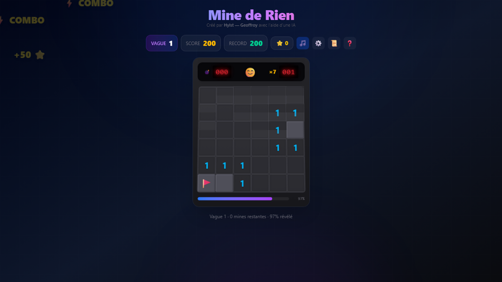

# Mine de Rien

**Un démineur qui monte en vagues, avec des pouvoirs à débloquer.**

Joue ici : [games.hylst.fr/minederien/](https://games.hylst.fr/minederien/)



## Comment on joue

Le principe du démineur classique : clic gauche pour révéler une cellule, clic droit pour
planter un drapeau sur une mine suspectée. Un chiffre indique combien de mines se cachent
dans les 8 cases voisines. Le premier clic est toujours sûr.

Ici, ça ne s'arrête pas à une seule grille : chaque vague terminée fait grandir le plateau et
ajoute des mines, et te fait choisir un pouvoir parmi trois. Combine-les pour survivre le plus
longtemps possible.

## Contrôles

| Action | Effet |
|--------|-------|
| Clic gauche | Révéler une cellule |
| Clic droit | Poser / retirer un drapeau |
| Clic sur un chiffre | Si le bon nombre de drapeaux est posé autour, révèle les voisins d'un coup |
| R | Recommencer |
| Échap | Annuler un pouvoir actif |

Sur mobile, un bouton bascule entre mode Révélation et mode Drapeau.

## Les pouvoirs

| Pouvoir | Effet |
|---------|-------|
| 🛡️ Bouclier | Absorbe un impact de mine (passif) |
| 🔍 Scanner | Révèle toute une ligne et une colonne |
| 🔧 Démineur | Désamorce une mine au clic |
| 📡 Radar | Révèle la densité de mines sur une zone 5×5 |
| ⏱️ Gel Tempo | Gèle le chronomètre pendant 30 secondes (passif) |
| 💡 Indice | Illumine 3 cellules sûres |

À la fin de chaque vague, choisis-en un parmi trois proposés au hasard.

## Les bonus cachés

Certaines cellules cachent ⭐ (+50), 💎 (+100) ou ⚡ (combo ×3). Ils se ramassent
automatiquement dès qu'ils sont révélés, même par un effet de zone (flood-fill, Scanner).

## Ce qu'il y a dedans

- Vagues progressives : la grille et le nombre de mines augmentent à chaque palier
- Système de combo sur les révélations rapprochées
- Notation en étoiles (1 à 3) selon le temps mis à finir la vague
- Musique et effets sonores générés à la volée (Web Audio)
- Record personnel sauvegardé en local
- Réglage du volume, tutoriel intégré, règles consultables en jeu

## L'arborescence

```
mine-de-rien-game-development/
├── index.html          # template + bloc SEO
├── vite.config.ts      # base '/minederien/' + singlefile
├── public/
│   ├── favicon.png
│   ├── og-image.png / og-image.webp
│   └── icon.webp       # icone 128x128 pour la carte du menu
└── src/
    ├── main.tsx
    ├── App.tsx          # tout le jeu : plateau, vagues, pouvoirs, HUD
    ├── audio.ts         # synthèse Web Audio (SFX + ambiance)
    ├── index.css        # Tailwind + keyframes
    └── utils/cn.ts      # non utilisé, reste du template de base
```

## Dev

```bash
npm install
npm run dev       # http://localhost:5173/minederien/
npm run build     # dist/index.html, un seul fichier
npm run preview
```

## Stack

React 19, TypeScript 5.9 (strict), Tailwind CSS 4, Vite 7, vite-plugin-singlefile.

Zéro backend, zéro asset externe : le jeu tient dans un seul fichier HTML et tourne hors
ligne. Les sons sont synthétisés au vol par la Web Audio API.

## Licence

MIT, Geoffroy Streit (Hylst)
